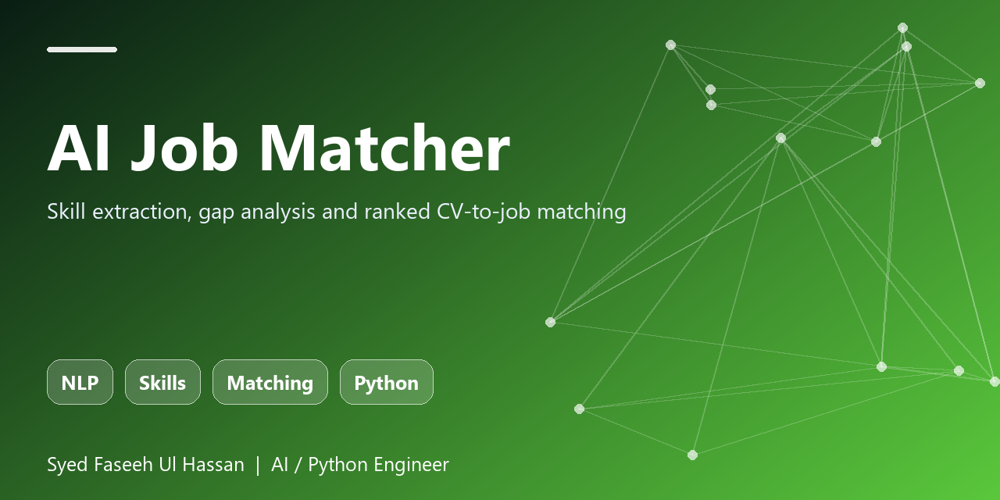

<p align="center"></p>

# AI Job Matcher

Scores a CV against job descriptions: extracts AI/ML/engineering skills with alias handling, reports matched and missing skills and ranks jobs by fit.

  

## Features
- Alias-aware skill taxonomy (RAG, LLM, vector DBs, MLOps...)
- Match score + missing-skill gap list
- Rank many job descriptions at once

## Quick start
```bash
git clone https://github.com/FASEEHSYED786/ai-job-matcher.git
cd ai-job-matcher
pip install -e .[dev]
pytest
```

## Usage
```python
from matcher import score

print(score('Python, RAG, FastAPI', 'Need Python, RAG, Kubernetes'))
```

## Why this exists
Part of my applied-AI portfolio (Python, RAG, LLM agents, evaluation, LLMOps). Built to be small, readable, tested and easy to extend with a real LLM or vector store.

## Author
**Syed Faseeh Ul Hassan** - Python / AI engineer, MSc AI & Big Data - Cambridge, UK
Website: [syedfaseeh.com](https://syedfaseeh.com) - [LinkedIn](https://www.linkedin.com/in/syed-faseeh-ul-hassan-809595103/)

MIT licensed.
